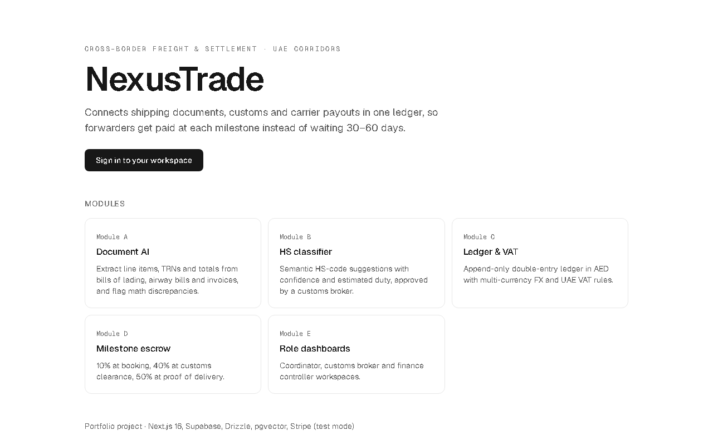
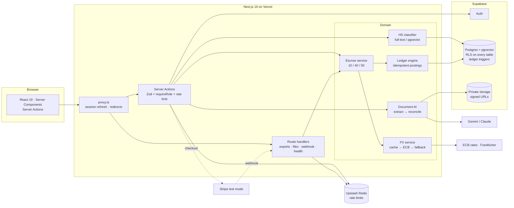

# NexusTrade

**AI-assisted cross-border freight and settlement hub for UAE trade corridors** (Jebel Ali / JAFZA, Dubai South, Khalifa Port).

Forwarders in the UAE lose time and cash to three problems: slow manual document processing, invoices whose line items and VAT don't match, and settlement that takes 30–60 days. NexusTrade reads trade documents with AI, re-checks every number, suggests customs HS codes, and pays carriers from escrow at each shipment milestone, all on an append-only double-entry ledger.



> Portfolio project. Stripe runs in **test mode only** (live keys are rejected), payouts are simulated, and customs duty rates are indicative.

## What it does

| Module | Highlights |
|---|---|
| **A. Document AI** | Drag-and-drop BoL, AWB, packing list or invoice → file type checked by magic bytes → vision model (Gemini / Claude via AI SDK v7, or a key-free mock) → strict Zod validation → **every total recomputed**, with mismatches, invalid TRNs and missing prices flagged |
| **B. HS classifier** | All **5,612 official HS subheadings**. Keyword full-text search (no key needed) or pgvector semantic search (Gemini embeddings). Top-3 suggestions with confidence and estimated duty; broker approves or overrides (note required); restricted goods automatically go on customs hold |
| **C. Ledger, tax & FX** | Append-only double-entry ledger in AED, **enforced by Postgres triggers**: no edits, no deletes, unbalanced transactions rejected at commit. Idempotency keys on every posting, one-time reversals, 5% / 0% / exempt UAE VAT, ECB rates crossed through the USD peg |
| **D. Milestone escrow** | Importer funds the freight via Stripe Checkout (test) → signature-verified, retry-safe webhook → 40% released at customs clearance, the 10% deposit and final 50% at proof of delivery, by a finance controller. The escrow account nets to exactly 0.00 AED |
| **E. Role dashboards** | Coordinator (shipments, uploads, packing slips), customs broker (HS review queue), finance (escrow, charts, VAT audit, CSV exports for Zoho Books and Xero) |

## Architecture



**Defence in depth:** the proxy is only a convenience. Every page and Server Action re-checks the user and role. Postgres RLS enforces role-based reads, money tables have **no write policies** (only server code writes them), and triggers guarantee ledger integrity even if application code is wrong.

## Tech stack

Next.js 16 (App Router, Cache Components, Turbopack) · React 19 · TypeScript (strict) · Tailwind CSS 4 · Zod 4 · Drizzle ORM · PostgreSQL + pgvector (Supabase) · Supabase Auth & Storage · Vercel AI SDK 7 · Stripe · Recharts · Upstash Ratelimit · Vitest · Playwright · PGlite · Lighthouse CI · CodeQL · Docker

## Quality

- **150+ automated tests.** Unit tests, plus **real-Postgres tests that run in-process with PGlite** (Postgres 17 + pgvector, no Docker or cloud database). They apply the real migrations and mimic Supabase's auth schema and roles, so triggers, RLS, the seed and every money flow are tested for real.
- **End-to-end tests (Playwright)** against the production build: auth guards, CSP with zero violations, API authorisation, 404s and health check.
- **Lighthouse: 100 / 100 / 100 / 100** (performance, accessibility, best practices, SEO) on the public pages, enforced in CI.
- **CI:** lint → typecheck → tests → `npm audit` → build → e2e, then Lighthouse and a Docker build-and-health-check. CodeQL weekly. Dependabot.
- [Security review](docs/SECURITY_REVIEW.md): 18 checks, no open high or medium findings. [Build log](docs/PROGRESS.md): decisions made in each phase.

## Getting started

Requires Node 22. Everything below uses free tiers.

```bash
npm install
cp .env.example .env          # fill in what you need (see below)
npm run dev                   # http://localhost:3000
```

With no keys at all, the public pages and the test suite work. To use the workspaces:

1. Create a free [Supabase](https://supabase.com) project. Copy the connection string (transaction pooler, port 6543), URL, anon key and service-role key into `.env`, and set a `DEMO_USER_PASSWORD` (12+ characters).
2. Load the database and demo data:
   ```bash
   npm run db:migrate        # if the 6543 pooler refuses migrations, use the session pooler (5432) for this command
   npm run auth:demo-users   # coordinator@ / broker@ / finance@nexustrade.test
   npm run db:seed           # 5,612 HS codes, 6 demo shipments, ledger history
   ```
3. Optional extras:
   - **Real AI extraction:** `AI_PROVIDER=google` plus a free [Google AI Studio](https://aistudio.google.com) key.
   - **Semantic HS search:** `npm run hs:embed`, then `EMBEDDING_PROVIDER=google`.
   - **Stripe:** `sk_test_…` keys, `stripe listen --forward-to localhost:3000/api/webhooks/stripe`, and card `4242 4242 4242 4242`.
   - **Global rate limits:** Upstash Redis URL and token.

| Script | |
|---|---|
| `npm run verify` | lint + typecheck + tests + build |
| `npm test` / `npm run test:e2e` | Vitest / Playwright |
| `npm run db:generate` / `db:migrate` / `db:seed` / `db:studio` | Drizzle |
| `npm run hs:build <csv>` / `hs:embed` | rebuild the HS dataset / create embeddings |

**Docker:** `docker build -t nexustrade . && docker run --env-file .env -p 3000:3000 nexustrade` (multi-stage, standalone output, non-root, health check).

## Project layout

```
src/
  app/                 routes: workspaces per role, API routes, proxy-protected pages
  features/            auth · documents · hs · escrow · payments · reports · shipments
  lib/                 money (bigint), ledger engine, tax, FX, CSV, rate limiting, idempotency
  db/                  Drizzle schema, seed, data (HS dataset, demo shipments)
drizzle/               SQL migrations (incl. ledger triggers and RLS policies)
test/pglite.ts         in-process Postgres harness for real-database tests
e2e/                   Playwright tests
docs/                  spec, progress log, security review, free tools, screenshots
.agent/                Antigravity agent rules and workflows
```

## Data and credits

HS nomenclature from [datasets/harmonized-system](https://github.com/datasets/harmonized-system) (UN Comtrade, ODC-PDDL public domain). FX rates from the European Central Bank via [Frankfurter](https://frankfurter.dev). Demo companies and TRNs are fictitious.
